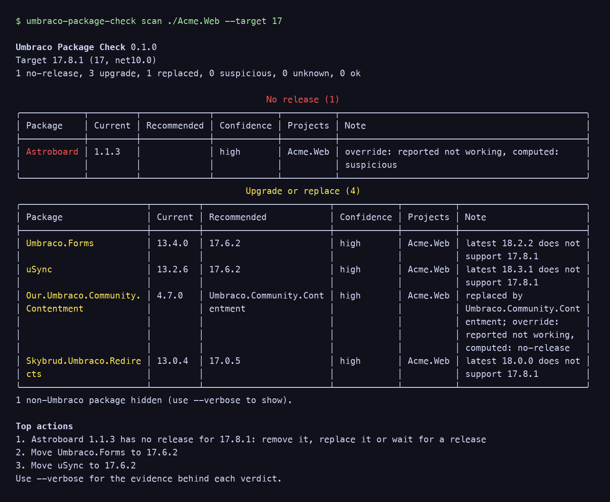
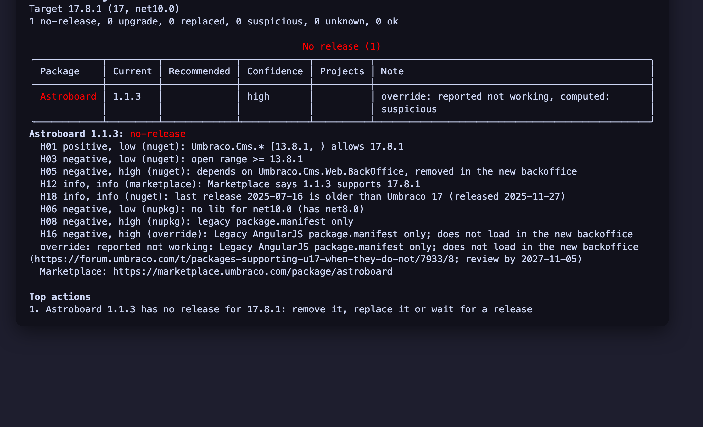

# Umbraco Package Check

[](https://www.nuget.org/packages/Umbraco.Community.PackageCheck)
[](https://www.nuget.org/packages/Umbraco.Community.PackageCheck)
[](https://github.com/PascalA94/Umbraco.Community.PackageCheck/blob/main/LICENSE)

A dotnet tool that tells you, before you upgrade an Umbraco site, which of its NuGet packages are ready for the target Umbraco version, which need an upgrade or a replacement, and which look suspicious. Every verdict shows its evidence.

A community package, not made or supported by Umbraco HQ.

**Requires** the .NET 8 SDK or later (it runs on 8, 9 and 10). It checks any site whose projects reference `Umbraco.Cms`.



## Why

NuGet ranges and Marketplace badges often say a package supports a version when it doesn't. A package built for Umbraco 13 with an open range (`>= 13.0.0`) "supports" 17 on paper, while its AngularJS `package.manifest` never loads in the new backoffice. PackageCheck reads the ranges, then opens each package (as a zip, never loading its code) and checks what is really inside: `umbraco-package.json`, legacy manifests, static web assets, target frameworks and the types its assemblies reference.

It also handles what an upgrade audit needs in practice: CI exit codes that fail closed, private feeds, several sites in one report, curated community overrides and an offline mode.

## Install

```sh
dotnet tool install -g Umbraco.Community.PackageCheck
umbraco-package-check --version
```

Or as a local tool, pinned per repository:

```sh
dotnet new tool-manifest   # once per repo
dotnet tool install Umbraco.Community.PackageCheck
dotnet umbraco-package-check scan . --target 17
```

## Use cases

| You want to | Command |
|---|---|
| Plan a 13 to 17 (or 17 to 18) upgrade | `umbraco-package-check scan ./MySite.sln --target 17` |
| Pick the right patch inside a major | `umbraco-package-check scan . --target 17.7.2` |
| Check packages in CI on every PR | `umbraco-package-check scan . --target current --fail-on no-release` |
| Audit many sites at once | `umbraco-package-check scan ./sites/* --target 18 --format md -o audit.md` |
| Check your own package as an author | `umbraco-package-check explain My.Package 2.1.0 --target 18` |

## Commands

```
umbraco-package-check scan [paths...]
    --target <17 | 17.7.2 | current | next-major | latest-lts>   default: next-major
    --format console|json|md            default: console
    -o, --output <file>                 write the json or md report; the console summary is still printed
    --fail-on none|suspicious|upgrade|no-release                   default: none
    --transitive                        include transitive Umbraco packages (lock file or --msbuild)
    --msbuild                           exact versions via `dotnet list package` (needs a prior restore)
    --prerelease                        allow prerelease versions as an upgrade target
    --no-inspect                        metadata only; no nupkg download or inspection
    --offline                           cache, global packages folder and bundled data only
    --overrides <file|url>              extra overrides on top of the community ones
    --private-ids <file>                package ids on a private feed; never looked up
    --cache-dir <dir>  --max-age <6h>  --no-cache
    --verbose                           print every piece of evidence

umbraco-package-check explain <packageId> [version] --target <v>
umbraco-package-check cache info|clear [--cache-dir <dir>]
```

### Paths and sites

- A path is a `.sln`, `.slnx`, `.csproj` or a folder. A folder is searched for `.slnx`, then `.sln`, then `*.csproj`, up to 4 levels deep, skipping `bin`, `obj`, `node_modules` and `.git`.
- Each path is one **site**. Several sites give a site-by-package matrix in the markdown report.
- Central package management (`Directory.Packages.props`), `Directory.Build.props` properties and `packages.lock.json` are read. A lock file's version wins over a floating one.
- A version that can't be worked out (an unresolved `$(Property)`, `17.*` or an open range with no lock file) is `unknown`, reason `unresolved-property`, with the raw text shown. Use a lock file or `--msbuild` for exact versions.
- With several paths, a path with no Umbraco project is skipped with the warning "no Umbraco project found in <path>; skipped". The run fails (exit 2) only when no path has a site. A path that doesn't exist is exit 2.
- In the JSON report, project paths are relative to their site, with `/` separators.

### Targets

| Value | Resolves to |
|---|---|
| `17` | The latest stable `Umbraco.Cms` 17.x on the feed |
| `17.7.2` | Exactly that version |
| `current` | The site's own `Umbraco.Cms` version (the CI mode) |
| `next-major` | The site's major + 1, latest stable in it |
| `latest-lts` | The latest supported LTS major, from the `umbraco-versions.json` table |

- `current` and `next-major` resolve per site.
- A major-only target with no stable release yet (for example `18` before 18.0.0) needs `--prerelease`, or an exact version such as `--target 18.0.0-rc2`.
- **A prerelease target is compared by its release base.** `18.0.0-rc2` counts as `18.0.0` in every range check, so `[18.0.0, )` allows it and `[17.0.0, 18.0.0)` excludes it. The report marks the target `"prerelease": true`.

### `--msbuild`

`--msbuild` asks `dotnet list package --format json` for the versions NuGet actually resolved, and for the transitive graph with `--transitive`. It needs a prior `dotnet restore`; PackageCheck never restores for you (it passes `--no-restore`, so nothing is written to the scanned folder). If the command fails or times out (5 minutes), the site falls back to reading the project files, with the warning "run dotnet restore first".

`--msbuild` runs the .NET SDK that the scanned repository selects (through its `global.json`) and evaluates its MSBuild files, with your environment variables. Treat it as running code from that repository: never use it on code you don't trust, or in a CI job that holds secrets. PackageCheck finds `dotnet` on your `PATH` (or `DOTNET_HOST_PATH`), never in the scanned folder. Without `--msbuild`, PackageCheck only reads files.

## Verdicts

| Verdict | Meaning |
|---|---|
| `ok` | The current version supports the target |
| `upgrade` | A newer stable version supports the target; the report names it |
| `no-release` | No stable version supports the target (a prerelease that does is mentioned) |
| `suspicious` | The metadata says yes, the contents say no |
| `replaced` | Retired on the Marketplace, or deprecated on NuGet, with an alternate |
| `unknown` | Not enough information: offline, private feed, not found, unresolved version, unsafe archive, a source error or conflicting evidence |
| `not-umbraco` | Nothing in its dependency tree reaches `Umbraco.Cms.*`; hidden unless `--verbose` |

The tool says **suspicious** and shows why. It never claims on its own that a package fails: it reports evidence, and you decide.

**Confidence:**

| Confidence | When |
|---|---|
| `high` | Two independent kinds of evidence agree (a range plus the package contents), or a curated override matches |
| `medium` | One strong signal, such as a range with an upper bound |
| `low` | An open-ended range is the only evidence |

**Upgrade picks:** the lowest package major that supports the target, at its highest stable version, so the site moves the shortest distance (Contentment 5.2.1 at 17.7.2 gets 6.3.4, not 7.x). Majors made for your target are preferred: first those whose Umbraco range starts in the target's major, then those built for the target's .NET version. So an older major with an open or over-broad range doesn't win over the release made for your target (uSync 13 at Umbraco 18 gets 18.x, not 17.x). If a later version also clears, the report says so.

[HEURISTICS.md](https://github.com/PascalA94/Umbraco.Community.PackageCheck/blob/main/HEURISTICS.md) lists every check (H01 to H19), its weight and the truth table that turns evidence into a verdict.

## CI: `--fail-on` and exit codes

Severity, worst first: `no-release` > `upgrade` (and `replaced`) > `suspicious`. The thresholds nest: `--fail-on suspicious` fails on `suspicious`, `upgrade`, `replaced` and `no-release`. `unknown` never fails a run on its own.

| Code | Meaning |
|---|---|
| `0` | Nothing at or above `--fail-on`. Always 0 with `--fail-on none` (the default), even when the run is incomplete |
| `1` | Findings at or above `--fail-on` |
| `2` | Usage error: bad options, a missing path, no Umbraco project, or a target that can't exist (no stable 18.x without `--prerelease`, an unparseable version). Also an unexpected error, as one line (`--verbose` adds the stack trace) |
| `3` | Incomplete: a required source failed while `--fail-on` was set. CI fails closed |
| `130` | Cancelled with Ctrl+C |

**2 or 3?** Exit 2 means *your input* is wrong and a rerun won't help. Exit 3 means *a source* failed: a feed timed out, returned 5xx after three tries, or couldn't be reached, including when the target itself can't be resolved because the feed is down. A rerun may pass. If both 1 and 3 apply, the exit code is 3.

These never cause exit 3: a package not found on any feed (`unknown`, `not-found`), a 401 or 403 from a feed (`unknown`, `private-feed`), an `--offline` cache miss, and the Marketplace or the overrides being unreachable (a warning; the cached or bundled copy is used).

`--transitive` without a lock file or `--msbuild` reports direct references only, warns, and marks the run incomplete (exit 3 with `--fail-on`).

The JSON report follows [schema v1](https://raw.githubusercontent.com/PascalA94/Umbraco.Community.PackageCheck/main/schema/report.schema.json) (also shipped inside the tool as `schema/report.schema.json`). `summary.incomplete` tells you whether a source failed.

## Private feeds

Feeds come from the nearest `NuGet.config` to each site, as `dotnet restore` would find them, including package source mapping.

- Credentials are read from `packageSourceCredentials` in `NuGet.config`, including `%ENV_VAR%` references. In CI, put the token in an environment variable and reference it there.
- **NuGet credential providers (such as the Azure Artifacts provider) are not supported in 0.1.** A feed that answers 401 or 403 gives `unknown`, reason `private-feed`.
- `--private-ids <file>` lists ids that live on a private feed, one per line (`#` starts a comment). They are reported as `unknown`, `private-feed`, and never sent to nuget.org or the Marketplace.
- Credentials never appear in the console, JSON, markdown, the cache or error messages. Feed URLs are shown as scheme and host only.

## Offline and the cache

- Feed metadata is cached for `--max-age` (default 6 hours); Marketplace data and the community overrides for 24 hours; inspection results by package content hash, with no expiry (the same bytes always give the same result).
- The cache lives in your local application data folder (`umbraco-package-check`), or `--cache-dir`. `cache info` shows its size; `cache clear` empties it.
- `cache clear` only deletes files the tool wrote, in a folder holding its marker file `.umbraco-package-check-cache`. Pointing `--cache-dir` at any other folder is refused (exit 2), so a typo can't empty a project folder.
- `--offline` makes no HTTP calls. It reads the cache, the global packages folder and the data bundled with the tool. Packages it can't judge are `unknown`, reason `offline`; that is not a source failure.
- `--no-cache` reads and writes no cache at all (and can't be combined with `--offline`).

## Overrides

Some packages declare support they don't have, or the other way round. Overrides record what people actually found, with a public link to the evidence. They live in this repo's [`overrides/`](https://github.com/PascalA94/Umbraco.Community.PackageCheck/tree/main/overrides) folder (CC0). Every merge to `main` republishes them to the [`overrides` release](https://github.com/PascalA94/Umbraco.Community.PackageCheck/releases/tag/overrides), so a fix reaches users without a new tool version. The tool downloads that release, checks it against the release's sha256 (this catches a truncated or mixed-up download; it is not a signature), and caches it for 24 hours. If that fails, it uses the cached copy, then the snapshot bundled in the tool, with a warning; it never fails the run.

- An override **replaces** the verdict, and is always labelled and linked. The computed verdict is kept beside it (`override.computedVerdict` in JSON, "computed: …" in the console and markdown), so nothing is hidden.
- Statuses: `works` gives `ok`; `broken` ("reported not working") gives `no-release`, or `upgrade` when another version isn't covered; `partial` gives `suspicious` with the summary.
- `--overrides <file|url>` adds your own entries (YAML or JSON, same format, https URLs only). Yours win over the community's for the same package and ranges, and are labelled "local override".
- To add or correct an entry, open a PR that adds or edits `overrides/<package-id-in-lower-case>.yml`. The rules are in [CONTRIBUTING.md](https://github.com/PascalA94/Umbraco.Community.PackageCheck/blob/main/.github/CONTRIBUTING.md#overrides). Every entry needs a public evidence link.

## Safety

- **Reports only.** PackageCheck never edits a project file, props file, lock file or anything else in a scanned folder.
- **Every package is treated as hostile.** Packages are read as zip streams and never extracted to disk. No assembly is ever loaded: types are read with `System.Reflection.Metadata` over the bytes.
- Entries with `..` or rooted paths, more than 20,000 entries, an entry that holds more bytes than it declares, or over 500 MB read in total make the package `unknown`, reason `unsafe-archive`.
- A package over 250 MB is not opened, and an entry declared over 50 MB is skipped. The package is then judged on its metadata, with a note in the evidence.
- Text from packages and feeds is escaped in every output, so a package can't inject markup or terminal control codes into your report.

## Limitations in 0.1

- **Code is not checked.** PackageCheck looks at packages, not your own code. For breaking-change search in your code, see [Umbraco17Check](https://www.nuget.org/packages/Umbraco17Check), which also scans your `App_Plugins` and content files. The two work well together.
- Removed-API detection (H10) is planned, not built.
- A split UI package is only inspected when its id shares the main package's first segment (for example `Plumber.Workflow` and `Plumber.Backoffice`). A UI package with an unrelated prefix can hide a legacy manifest.
- A package that implements `IPackageManifestReader` but never registers it still counts as new-backoffice ready.
- Precision and recall haven't been measured on real upgrades yet. Until they are, use `--fail-on` to flag packages for a human, and don't block releases on `suspicious` alone.



## Contributing and support

Bugs and ideas: [GitHub issues](https://github.com/PascalA94/Umbraco.Community.PackageCheck/issues). Security issues: use [private vulnerability reporting](https://github.com/PascalA94/Umbraco.Community.PackageCheck/security/advisories/new), not a public issue. Building from source needs the .NET 10 SDK; see [CONTRIBUTING.md](https://github.com/PascalA94/Umbraco.Community.PackageCheck/blob/main/.github/CONTRIBUTING.md).

Licence: [MIT](https://github.com/PascalA94/Umbraco.Community.PackageCheck/blob/main/LICENSE). The community overrides in `overrides/` are [CC0](https://github.com/PascalA94/Umbraco.Community.PackageCheck/blob/main/overrides/LICENSE).
